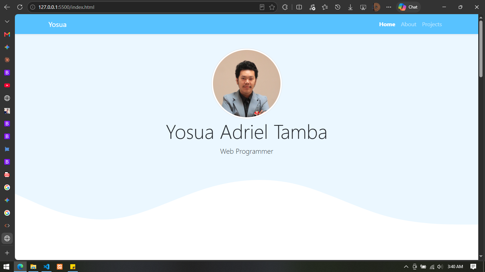

# Portfolio — Yosua Adriel Tamba

[](https://developer.mozilla.org/en-US/docs/Web/HTML)
[](https://developer.mozilla.org/en-US/docs/Web/CSS)
[](https://getbootstrap.com/)
[](https://developer.mozilla.org/en-US/docs/Web/JavaScript)

My responsive personal portfolio website as Web Programmer with a degree in Computer Engineering from Universitas Pendidikan Indonesia. The site is a single-page static website built with HTML, CSS, Bootstrap 5, and JavaScript.



---

## Table of Contents

- [Overview](#overview)
- [Features](#features)
- [Tech Stack](#tech-stack)
- [Project Structure](#project-structure)
- [Page Sections](#page-sections)
- [Responsive Design](#responsive-design)
- [Getting Started](#getting-started)
- [Featured Projects](#featured-projects)
- [Author](#author)
- [License](#license)

---

## Overview

This project is a clean, lightweight portfolio intended to introduce the author and showcase selected software projects. It consists of three anchored sections — **Home**, **About**, and **Projects** — connected through a fixed navbar, with decorative SVG wave dividers between sections.

The website is entirely client-side. All assets are served statically, and third-party libraries (Bootstrap and Font Awesome) are loaded from public CDNs. This means the site can be hosted anywhere that serves static files, including GitHub Pages, Netlify, Vercel, or a shared hosting plan.

**Goals of the project:**

- Present a professional online presence for a web developer
- Demonstrate front-end fundamentals without relying on a framework
- Provide a simple, readable codebase that is easy to customize
- Keep the footprint small and the loading experience fast

---

## Features

| Feature | Description |
| --- | --- |
| **Single-page layout** | Home, About, and Projects sections with smooth in-page anchor navigation. |
| **Fixed navbar** | Dark navbar with brand, collapsing hamburger menu on mobile, and active-link highlighting. |
| **Hero section** | Profile photo in a circular thumbnail, name, role, and a wave-shaped SVG transition. |
| **Automatic nav highlighting** | The active navbar link updates based on scroll position, including the bottom-of-page edge case. |
| **Scroll animations** | Hero elements fade in on load; About and Projects containers reveal on intersection. |
| **Reduced motion support** | Animations are skipped when the user enables `prefers-reduced-motion`. |
| **Project showcase** | Five project cards with screenshots, descriptions, and technology badges. |
| **Responsive grid** | Bootstrap grid adapts from a single column on mobile to three columns on desktop. |
| **Decorative wave dividers** | Inline SVG paths create smooth transitions between section backgrounds. |
| **Footer link** | LinkedIn call-to-action in the footer. |
| **No build step** | Open `index.html` and the site works. |

---

## Tech Stack

| Layer | Technology | Notes |
| --- | --- | --- |
| Markup | HTML5 | Semantic sections, accessible navbar attributes. |
| Styling | CSS3 | Custom styles on top of Bootstrap 5. |
| UI Framework | [Bootstrap 5.0.2](https://getbootstrap.com/) | Loaded via jsDelivr CDN with SRI hashes. |
| Icons | [Font Awesome 5.15.4](https://fontawesome.com/) | Loaded via cdnjs; used in the footer heart icon. |
| Behavior | Vanilla JavaScript (ES6+) | Two small scripts for navigation state and reveal animations. |

**There is no:**

- `package.json`, npm dependencies, or node_modules
- Bundler (Webpack, Vite, Parcel) or preprocessor (Sass, PostCSS)
- Backend, database, or API integration

---

## Project Structure

```text
portfolio-yosua/
├── index.html                        # Main page: navbar, hero, about, projects, footer
├── README.md                         # Project documentation (this file)
├── preview.png                       # Screenshot used in this README
│
├── css/
│   └── style.css                     # Custom styles (section background, spacing, SVG sizing)
│
├── js/
│   ├── nav-scroll-animation.js       # Tracks scroll position and updates the active nav link
│   └── content-scroll-animation.js   # Hero animation and on-scroll reveal animations
│
└── img/
    ├── pp.jpg                        # Profile photo
    └── projects/
        ├── absen.png                 # Attendance System Dashboard preview
        ├── e-library.png             # Pustaka 7 (E-Library) preview
        ├── evalingo.png              # Evalingo preview
        ├── logo_msl.png              # Virtual Multiple Skill Laboratory logo/preview
        └── sibi-app.png              # Sibi Learning App preview
```

### File responsibilities

- **`index.html`** — All page content, section anchors (`#home`, `#about`, `#projects`), project cards, CDN links, and script includes.
- **`css/style.css`** — Pseudocode of the design system:
  - `.jumbotron` — hero padding and light blue background (`#ebf7ff`)
  - `#projects` — matching light blue section background
  - `section` — resets default section padding
  - `svg` — makes wave dividers full width
  - Accent color (`#58c2ff`) is applied inline on the navbar and footer.
- **`js/nav-scroll-animation.js`** — Builds a map of nav links to their target sections and marks the link whose section is currently in view.
- **`js/content-scroll-animation.js`** — Fades in hero elements sequentially and reveals section containers when they enter the viewport.

---

## Page Sections

### 1. Navbar (`<nav>`)

- Fixed to the top (`fixed-top`) with `navbar-dark` and a shadow.
- Background color `#58c2ff`.
- Brand text: **Yosua**.
- Links: Home → `#home`, About → `#about`, Projects → `#projects`.
- Collapses into a hamburger menu below the `lg` breakpoint.

### 2. Hero / Jumbotron (`.jumbotron`)

- Centered profile image (200px, circular, `img-thumbnail`).
- Name in `display-4`: **Yosua Adriel Tamba**.
- Role: **Web Programmer**.
- Bottom SVG wave transitions into the white About section.

### 3. About (`#about`)

- Heading: **About Me**.
- Two responsive columns describing:
  - Education and web development experience (PHP, Laravel, CodeIgniter, Next.js, Python).
  - Technical support, robotics instruction, and teaching assistant background.
- Bottom SVG wave transitions into the Projects section.

### 4. Projects (`#projects`)

- Heading: **My Projects**.
- Responsive grid of five Bootstrap cards (`col-md-4`).
- Each card contains an image, title, short description, and badges.
- Bottom SVG wave transitions into the footer.

### 5. Footer (`<footer>`)

- Accent-colored background.
- Attribution text with a Font Awesome heart icon.
- Link to the author's LinkedIn profile.

---

## Responsive Design

The layout relies on the Bootstrap 5 grid:

| Breakpoint | Behavior |
| --- | --- |
| **< 768px (`col` / mobile)** | Navbar collapses to a hamburger; About text stacks into one column; project cards stack vertically. |
| **≥ 768px (`col-md-4`)** | About text splits into two columns; project cards form a 3-column grid. |
| **≥ 992px (`navbar-expand-lg`)** | Navbar links display inline; hamburger is hidden. |

Wave SVGs use `width: 100%` and a fixed `viewBox`, so they scale fluidly with the viewport.

---

## Getting Started

No installation, dependencies, or build step is required.

1. Download or clone this repository.
2. Double-click `index.html` or open it in your browser.

> Note: An internet connection is required for the Bootstrap and Font Awesome CDN assets.

---


## Featured Projects

| # | Project | Description | Technologies |
| --- | --- | --- | --- |
| 1 | **Attendance System Dashboard** | Real-time analytics dashboard with interactive data visualization for managing attendance records. | CodeIgniter, Dashboard |
| 2 | **Evalingo** | Comprehensive language learning platform with interactive exercises and progress tracking. | Laravel, Educational, LMS |
| 3 | **Sibi Learning App** | Interactive web app using deep learning to recognize, evaluate, and assist users in practicing Indonesian Sign Language (SIBI) in real time. | Next.js, Deep Learning, Educational, Practice |
| 4 | **Pustaka 7** | Digital library platform for managing and accessing educational resources. | CodeIgniter, Digital Library, Dashboard |
| 5 | **Virtual Multiple Skill Laboratory (V-MSL)** | All-in-one educational platform for interactive online learning, class management, and real-time progress tracking. | CodeIgniter, Educational, Practice, Dashboard |

Each project card displays a preview image, title, description, and badges. To link a card to a live demo or repository, wrap the image or title in an `<a>` tag or add a button inside `.card-body`.

---

## Author

**Yosua Adriel Tamba**

- Web Programmer
- Computer Engineering, Universitas Pendidikan Indonesia
- LinkedIn: [yosua-adriel-tamba-953964270](https://linkedin.com/in/yosua-adriel-tamba-953964270)

---

## License

This project is for personal portfolio use. All rights reserved unless stated otherwise. Third-party libraries (Bootstrap, Font Awesome) are subject to their respective licenses.
